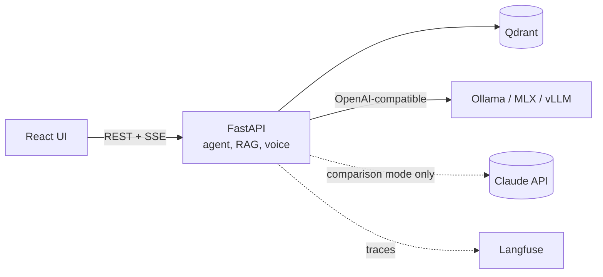

# Offline Assistant

A knowledge assistant that runs entirely on one machine. Load documents, ask by text or voice, get answers with citations, read aloud if you want. No data leaves the computer, and it keeps working with the network switched off.

Built to answer three practical questions about local AI:

1. Can a local model answer questions over real documents **with correct citations** and refuse when it should?
2. How do local models compare with a cloud model on **quality, latency, memory and cost**, measured on the same evaluation set?
3. Can the whole thing be **installed and verified on an air-gapped machine**?

> **Status:** design phase. The documentation, standards and workflow are in place; implementation starts with [F-00](docs/backlog.md). Results will be published in [docs/evals/](docs/evals/).

## What it will do

- Ingest PDF, DOCX, scans and photos with structure preserved (articles, paragraphs, pages).
- Hybrid search (vectors + keywords) with a reranker, Polish and English in one index.
- A local LLM agent with tools: search, fetch an article, compare provisions, save a note.
- Answers with resolvable citations, refusal when the documents have no answer, prompt-injection defence.
- Push-to-talk voice input (Whisper) and spoken answers streamed by sentence (Piper).
- Model switching by configuration: Qwen3, Bielik, gpt-oss, Gemma, and Claude as a cloud reference in an explicit comparison mode.
- Evaluation suite and performance measurements, published as a comparison report.
- Docker Compose profiles, self-hosted Langfuse tracing, an offline install bundle, and a CI check that runs the stack with networking disabled.

Default dataset: the EU AI Act and the GDPR, in English and Polish.

## Architecture

Details: [docs/architecture.md](docs/architecture.md). Decisions: [docs/adr/](docs/adr/).

## How it is built

This repository is developed with a coding agent (Claude Code) under a written process, and the process is part of what it demonstrates:

- **Documents first:** [PRD](docs/prd.md) → [architecture](docs/architecture.md) → [ADRs](docs/adr/) → [standards](docs/standards/) → [backlog](docs/backlog.md).
- **Per feature:** spec → plan → red/green commits → evaluation → independent review → ship, with human approval at the spec, plan, review triage and merge. See [docs/workflow.md](docs/workflow.md).
- **Test first, visible in history:** every step is a `test(...)` commit followed by a `feat(...)` commit; a hook keeps tests read-only while code is written ([ADR 0009](docs/adr/0009-test-first-commits-and-merge-strategy.md)).
- **TDD for code, evaluations for model behaviour** ([ADR 0006](docs/adr/0006-tdd-for-code-evals-for-model-behaviour.md)).
- **Offline verified, not claimed** ([ADR 0004](docs/adr/0004-offline-first-no-egress.md)).

The agent tooling (skills, review agents, hooks) is in [`.claude/`](.claude/).

## Reference hardware

MacBook Pro 14", Apple M5 Pro, 64 GB unified memory. A Linux + NVIDIA profile with vLLM is planned for comparison.

## Getting started

Not yet runnable. Setup instructions arrive with F-00 and F-10.

## Licence

Code: [MIT](LICENSE). Models and datasets keep their own licences; each one in use will be listed here.
