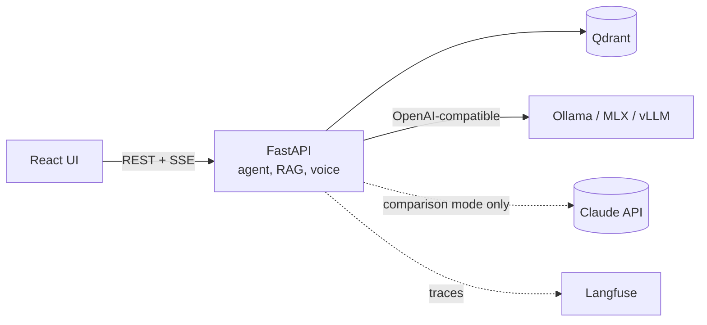

# Offline Assistant

[](https://github.com/pg013c/offline-assistant/actions/workflows/ci.yml)
[](LICENSE)

A knowledge assistant that runs entirely on one machine. Load documents, ask by text or voice, get answers with citations, read aloud if you want. No data leaves the computer, and it keeps working with the network switched off.

Built to answer three practical questions about local AI:

1. Can a local model answer questions over real documents **with correct citations** and refuse when it should?
2. How do local models compare with a cloud model on **quality, latency, memory and cost**, measured on the same evaluation set?
3. Can the whole thing be **installed and verified on an air-gapped machine**?

> **Status:** local LLM answers (F-06). You can upload PDFs (including scans), Word files, photos of text, plain text or Markdown; they are parsed offline with Docling and Tesseract and split by article, paragraph and page. Questions find passages by meaning and by exact terms, across Polish and English (BGE-M3 and BM25 in Qdrant), reordered by a cross-encoder (BGE reranker v2 M3), and answers stream with a clickable source such as "Art. 6(1), p. 1". Documents can be deleted and re-indexed. Retrieval is measured: `make eval` scores 24 questions over the AI Act and the GDPR with and without the reranker against a recorded [baseline](docs/evals/2026-10-29-retrieval-reranker.md) (recall@3 95 %, recall@10 100 %, MRR 0.87, all out-of-scope questions refused, 0.5 s p95 search latency). Answers come from a local LLM, Qwen3 8B on llama.cpp, as validated JSON with citations of the passages used. `make eval-answers` measures them: 86 % cite an expected passage, all are in the question's language, and the first token arrives in under 1 s median ([record](docs/evals/2026-10-29-answers-qwen3-8b.md)). The agent with tools follows in [F-07](docs/backlog.md).

## What it will do

- Ingest PDF, DOCX, scans and photos with structure preserved (articles, paragraphs, pages).
- Hybrid search (vectors + keywords) with a reranker, Polish and English in one index.
- A local LLM agent with tools: search, fetch an article, compare provisions, save a note.
- Answers with resolvable citations, refusal when the documents have no answer, prompt-injection defence.
- Push-to-talk voice input (Whisper) and spoken answers streamed by sentence (Piper).
- Model switching by configuration: Qwen3, Bielik, gpt-oss, Gemma, and Claude as a cloud reference in an explicit comparison mode.
- Evaluation suite and performance measurements, published as a comparison report.
- Docker Compose profiles, self-hosted Langfuse tracing, an offline install bundle, and a CI check that runs the stack with networking disabled.

Default dataset: the EU AI Act and the GDPR, in English and Polish.

## Architecture



Details: [docs/architecture.md](docs/architecture.md). Decisions: [docs/adr/](docs/adr/).

## How it is built

This repository is developed with a coding agent (Claude Code) under a written process, and the process is part of what it demonstrates:

- **Documents first:** [PRD](docs/prd.md) → [architecture](docs/architecture.md) → [ADRs](docs/adr/) → [standards](docs/standards/) → [backlog](docs/backlog.md).
- **Per feature:** spec → plan → red/green commits → evaluation → independent review → ship, with human approval at the spec, plan, review triage and merge. See [docs/workflow.md](docs/workflow.md).
- **Test first, visible in history:** every step is a `test(...)` commit followed by a `feat(...)` commit; a hook keeps tests read-only while code is written ([ADR 0009](docs/adr/0009-test-first-commits-and-merge-strategy.md)).
- **TDD for code, evaluations for model behaviour** ([ADR 0006](docs/adr/0006-tdd-for-code-evals-for-model-behaviour.md)).
- **Offline verified, not claimed** ([ADR 0004](docs/adr/0004-offline-first-no-egress.md)).
- **Rules checked by CI from the first commit:** docs, links, spelling, workflow and shell lint, agent hook self-tests, and the commit rules, including "code commits never touch tests" ([ADR 0010](docs/adr/0010-continuous-integration-from-the-first-commit.md)).

The agent tooling (skills, review agents, hooks) is in [`.claude/`](.claude/).

## Reference hardware

MacBook Pro 14", Apple M5 Pro, 64 GB unified memory. A Linux + NVIDIA profile with vLLM is planned for comparison.

## Getting started

Development setup. Docker packaging and the offline install guide arrive with F-10 and F-12.

Prerequisites: [uv](https://docs.astral.sh/uv/), Node 24 (`nvm use` reads `.nvmrc`), GNU Make, [Docker](https://docs.docker.com/) for Qdrant, and [Tesseract](https://tesseract-ocr.github.io/) with English and Polish data for OCR (`brew install tesseract tesseract-lang` on macOS, `apt install tesseract-ocr tesseract-ocr-pol` on Debian/Ubuntu). pnpm comes through Corepack.

```bash
cp .env.example .env
make setup
make models
make qdrant
make llm-models
```

`make models` downloads the models (about 4.8 GB: document parsing, embeddings and the reranker, pinned by commit and checked by hash) into `ASSISTANT_MODELS_DIR`. It is the only step that needs the network; nothing is downloaded at runtime ([ADR 0004](docs/adr/0004-offline-first-no-egress.md)). `make llm-models` downloads the local LLM, Qwen3 8B (5 GB GGUF, pinned by hash), for `make llm`, which serves it with llama.cpp's `llama-server` on port 8080 (`brew install llama.cpp`; [ADR 0021](docs/adr/0021-llama-server-and-qwen3-8b.md)). Without it, set `ASSISTANT_CHAT_MODEL=fake-extractive` for the test model. `make qdrant` starts the vector database in Docker, pinned by digest, with telemetry off and data under `ASSISTANT_DATA_DIR/qdrant` ([ADR 0017](docs/adr/0017-qdrant-and-bge-m3-for-hybrid-search.md)).

```bash
make llm
make dev
```

The UI runs at `http://localhost:5173` and the API at `http://localhost:8000/api` (docs at `/api/docs`). If a port is taken, set `API_PORT` or `UI_PORT` in `.env`.

```bash
make check
```

`make check` runs formatting, lint, type checks, layer contracts, tests and the API contract check for both projects; CI runs the same targets.

```bash
make e2e
```

```bash
make test-integration
```

```bash
make eval-corpus
make eval
```

`make eval` indexes the evaluation corpus (the AI Act and the GDPR in English and Polish, fetched once by `make eval-corpus` and checked against pinned hashes) into its own data directory and Qdrant collection. It then scores the retrieval cases in `evals/datasets/` with Promptfoo and fails if a metric is more than 5 points worse than the baseline in [docs/evals/](docs/evals/) or below its floor ([ADR 0020](docs/adr/0020-retrieval-targets.md)). Reports go to `evals/results/`. `make eval-answers` asks the same questions through the chat API with the local LLM (it needs `make llm`) and compares the answers with their own baseline.

`make test-integration` runs the tests with real adapters (Docling, BGE-M3, the reranker, Qdrant); it needs `make models`, `make qdrant` and Tesseract.

`make e2e` runs the browser journeys with Playwright against the real API (Docling, BGE-M3, Qdrant) and the test model, on a fresh data directory, its own Qdrant collection and ports 8011/5181; it needs `make models`, `make qdrant` and Tesseract. `make help` lists all targets.

## Licence

Code: [MIT](LICENSE). Models, tools and datasets keep their own licences:

| Component | Use | Licence |
|---|---|---|
| [Docling](https://github.com/docling-project/docling) | document parsing | MIT |
| [docling-layout-heron](https://huggingface.co/docling-project/docling-layout-heron) | page layout model | Apache-2.0 |
| [TableFormer](https://huggingface.co/docling-project/docling-models) | table structure model | CDLA-Permissive-2.0 |
| [Tesseract](https://github.com/tesseract-ocr/tesseract) and its `eng`/`pol` data | OCR | Apache-2.0 |
| [PyTorch](https://pytorch.org/) and torchvision | run the parsing models | BSD-3-Clause |
| [OpenCV](https://opencv.org/) (headless) | image handling for the table model | Apache-2.0 |
| [SciPy](https://scipy.org/) | OCR region detection in Docling | BSD-3-Clause |
| [pypdfium2](https://github.com/pypdfium2-team/pypdfium2) (PDFium) | PDF text and page checks | Apache-2.0 or BSD-3-Clause |
| [huggingface_hub](https://github.com/huggingface/huggingface_hub) | `make models` downloads | Apache-2.0 |
| [Qdrant](https://qdrant.tech/) server and [qdrant-client](https://github.com/qdrant/qdrant-client) | vector and keyword search | Apache-2.0 |
| [BGE-M3](https://huggingface.co/BAAI/bge-m3) | multilingual embeddings | MIT |
| [BGE reranker v2 M3](https://huggingface.co/BAAI/bge-reranker-v2-m3) | multilingual reranking | Apache-2.0 |
| [Qwen3 8B](https://huggingface.co/Qwen/Qwen3-8B-GGUF) | local LLM, Q4_K_M GGUF | Apache-2.0 |
| [llama.cpp](https://github.com/ggml-org/llama.cpp) | `make llm` serves the LLM | MIT |
| [sentence-transformers](https://www.sbert.net/) | runs the embedding model | Apache-2.0 |
| [scikit-learn](https://scikit-learn.org/) | dependency of sentence-transformers | BSD-3-Clause |
| [Promptfoo](https://www.promptfoo.dev/) | evaluation runner (`evals/`, telemetry off) | MIT |
| [PyYAML](https://pyyaml.org/), [jsonschema](https://python-jsonschema.readthedocs.io/), [httpx](https://www.python-httpx.org/) | evaluation harness | MIT, MIT, BSD-3-Clause |
| AI Act and GDPR (Official Journal PDFs) | evaluation corpus, fetched by `make eval-corpus`, not committed | reuse under Commission Decision 2011/833/EU |
