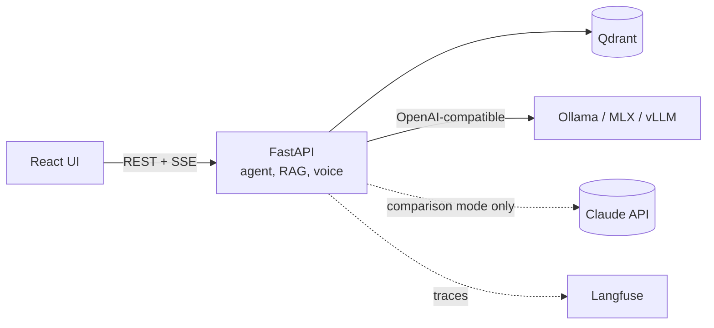

# Offline Assistant

[](https://github.com/pg013c/offline-assistant/actions/workflows/ci.yml)
[](LICENSE)

A knowledge assistant that runs entirely on one machine. Load documents, ask by text or voice, get answers with citations, read aloud if you want. No data leaves the computer, and it keeps working with the network switched off.

Built to answer three practical questions about local AI:

1. Can a local model answer questions over real documents **with correct citations** and refuse when it should?
2. How do local models compare with a cloud model on **quality, latency, memory and cost**, measured on the same evaluation set?
3. Can the whole thing be **installed and verified on an air-gapped machine**?

> **Status:** walking skeleton (F-01). You can upload a text or Markdown document, ask a question and get a streamed answer with a clickable source. Retrieval is keyword-based and the answer comes from a clearly labelled test model; real parsing, embeddings and local LLMs follow in [F-02 to F-07](docs/backlog.md). Results will be published in [docs/evals/](docs/evals/).

## What it will do

- Ingest PDF, DOCX, scans and photos with structure preserved (articles, paragraphs, pages).
- Hybrid search (vectors + keywords) with a reranker, Polish and English in one index.
- A local LLM agent with tools: search, fetch an article, compare provisions, save a note.
- Answers with resolvable citations, refusal when the documents have no answer, prompt-injection defence.
- Push-to-talk voice input (Whisper) and spoken answers streamed by sentence (Piper).
- Model switching by configuration: Qwen3, Bielik, gpt-oss, Gemma, and Claude as a cloud reference in an explicit comparison mode.
- Evaluation suite and performance measurements, published as a comparison report.
- Docker Compose profiles, self-hosted Langfuse tracing, an offline install bundle, and a CI check that runs the stack with networking disabled.

Default dataset: the EU AI Act and the GDPR, in English and Polish.

## Architecture



Details: [docs/architecture.md](docs/architecture.md). Decisions: [docs/adr/](docs/adr/).

## How it is built

This repository is developed with a coding agent (Claude Code) under a written process, and the process is part of what it demonstrates:

- **Documents first:** [PRD](docs/prd.md) → [architecture](docs/architecture.md) → [ADRs](docs/adr/) → [standards](docs/standards/) → [backlog](docs/backlog.md).
- **Per feature:** spec → plan → red/green commits → evaluation → independent review → ship, with human approval at the spec, plan, review triage and merge. See [docs/workflow.md](docs/workflow.md).
- **Test first, visible in history:** every step is a `test(...)` commit followed by a `feat(...)` commit; a hook keeps tests read-only while code is written ([ADR 0009](docs/adr/0009-test-first-commits-and-merge-strategy.md)).
- **TDD for code, evaluations for model behaviour** ([ADR 0006](docs/adr/0006-tdd-for-code-evals-for-model-behaviour.md)).
- **Offline verified, not claimed** ([ADR 0004](docs/adr/0004-offline-first-no-egress.md)).
- **Rules checked by CI from the first commit:** docs, links, spelling, workflow and shell lint, agent hook self-tests, and the commit rules, including "code commits never touch tests" ([ADR 0010](docs/adr/0010-continuous-integration-from-the-first-commit.md)).

The agent tooling (skills, review agents, hooks) is in [`.claude/`](.claude/).

## Reference hardware

MacBook Pro 14", Apple M5 Pro, 64 GB unified memory. A Linux + NVIDIA profile with vLLM is planned for comparison.

## Getting started

Development setup. Docker packaging and the offline install guide arrive with F-10 and F-12.

Prerequisites: [uv](https://docs.astral.sh/uv/), Node 24 (`nvm use` reads `.nvmrc`), GNU Make, and [Tesseract](https://tesseract-ocr.github.io/) with English and Polish data for OCR (`brew install tesseract tesseract-lang` on macOS, `apt install tesseract-ocr tesseract-ocr-pol` on Debian/Ubuntu). pnpm comes through Corepack.

```bash
cp .env.example .env
make setup
make models
```

`make models` downloads the document parsing models (about 670 MB) into `ASSISTANT_MODELS_DIR`. It is the only step that needs the network; nothing is downloaded at runtime ([ADR 0004](docs/adr/0004-offline-first-no-egress.md)).

```bash
make dev
```

The UI runs at `http://localhost:5173` and the API at `http://localhost:8000/api` (docs at `/api/docs`). If a port is taken, set `API_PORT` or `UI_PORT` in `.env`.

```bash
make check
```

`make check` runs formatting, lint, type checks, layer contracts, tests and the API contract check for both projects; CI runs the same targets.

```bash
make e2e
```

```bash
make test-integration
```

`make test-integration` runs the tests with real adapters, such as the document parser; it needs `make models` and Tesseract.

`make e2e` runs the browser journeys with Playwright against the real API and the test model, on a fresh data directory and ports 8011/5181. `make help` lists all targets.

## Licence

Code: [MIT](LICENSE). Models, tools and datasets keep their own licences:

| Component | Use | Licence |
|---|---|---|
| [Docling](https://github.com/docling-project/docling) | document parsing | MIT |
| [docling-layout-heron](https://huggingface.co/docling-project/docling-layout-heron) | page layout model | Apache-2.0 |
| [TableFormer](https://huggingface.co/docling-project/docling-models) | table structure model | CDLA-Permissive-2.0 |
| [Tesseract](https://github.com/tesseract-ocr/tesseract) and its `eng`/`pol` data | OCR | Apache-2.0 |
| [PyTorch](https://pytorch.org/) | runs the parsing models | BSD-3-Clause |
| [OpenCV](https://opencv.org/) (headless) | image handling for the table model | Apache-2.0 |
| [SciPy](https://scipy.org/) | OCR region detection in Docling | BSD-3-Clause |
