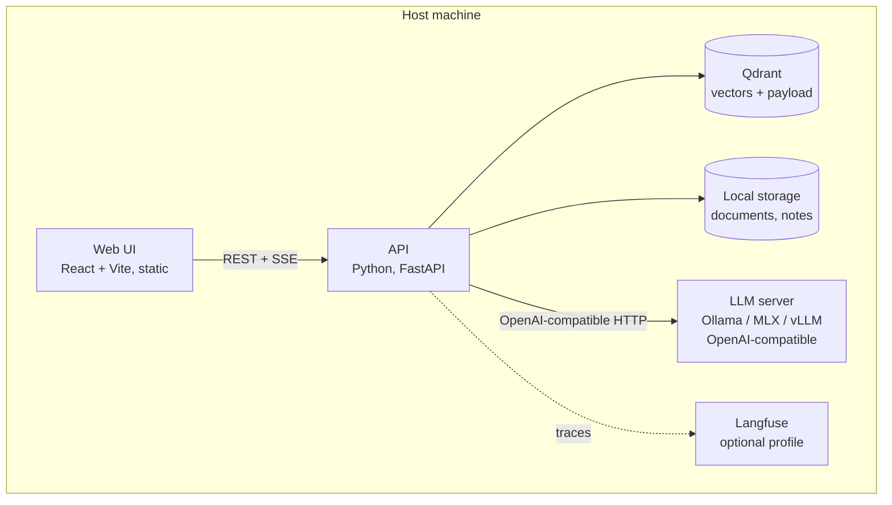
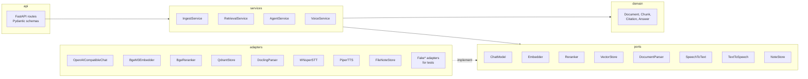
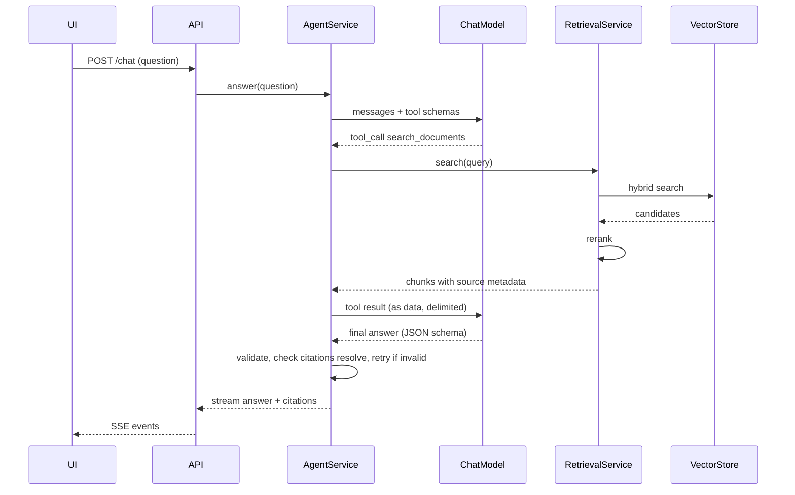

# Architecture

Status: initial design, before implementation · Last updated: 2026-10-28

This document describes the target shape of the system. Decisions behind it are in [adr/](adr/). Requirements are in [prd.md](prd.md).

## 1. Context


Everything inside the box runs on one machine. The dotted line is the only network connection the system may make, and only with an explicit flag (ADR 0004).

## 2. Containers



The embedding model, reranker, speech-to-text and text-to-speech run inside the API process (or a worker it owns). Only the LLM runs in a separate server, because it is the component we swap and benchmark, and every serving option exposes the same OpenAI-compatible API (ADR 0003).

## 3. Backend structure: ports and adapters



Rules (ADR 0002):

- `domain` imports nothing outside the standard library and Pydantic.
- `services` depend on `ports` (Python `Protocol`s) and `domain`, never on `adapters`.
- `adapters` are the only place that imports third-party model, database or parsing libraries.
- Wiring happens in one composition root (`app.py`), driven by configuration. `settings.py`, `log.py` (structlog JSON setup) and `openapi.py` (schema export for the generated client) sit beside it, outside the layers.
- The rules are import-linter contracts in `backend/pyproject.toml`, checked by `make check`. Every model, database or parsing library is added to the forbidden list for `domain`, `ports` and `services` together with its ADR.
- Every port has a fake adapter. Unit tests use fakes; integration tests use real adapters.

### What is implemented (F-01 to F-04a)

The diagram above is the target. The question flow runs end to end today; each part is replaced by a later feature behind the same kind of port:

| Port | Adapter now | Replaced by |
|---|---|---|
| `DocumentParser` | `RoutingDocumentParser`: `TextDocumentParser` for `.txt` and `.md`, `DoclingDocumentParser` for PDF, DOCX, PNG and JPG (pdfium text, Tesseract OCR `eng+pol`, models from `make models`, ADR 0015); `FakeDocumentParser` for tests | stays |
| `DocumentStore` | `LocalFileDocumentStore`: `data_dir/documents/<id><ext>` (original), `<id>.json` (metadata, status), `<id>.chunks.json`; `FakeDocumentStore` for tests | stays |
| `IngestionQueue` | `ThreadIngestionQueue`: one worker thread, so one parse holds model memory at a time; `FakeIngestionQueue` and `InlineIngestionQueue` for tests | stays |
| `Embedder` | `SentenceTransformerEmbedder`: BGE-M3, 1,024 dimensions, Polish and English, MPS on the Mac, pinned and verified (ADR 0017); `FakeEmbedder` for tests | stays; F-09 compares models |
| `ChunkIndex` | `QdrantChunkIndex`: one collection per embedding model with a dense vector, a BM25 sparse vector (Qdrant's IDF modifier) and the chunk as payload, both halves fused by reciprocal rank in one query, ties broken by dense similarity; `InMemoryChunkIndex` for tests | stays |
| `Reranker` | `BgeReranker`: BGE reranker v2 M3, a multilingual cross-encoder, float16 on MPS and float32 on CPU, pinned and verified; `ASSISTANT_RERANKER=auto` (default) uses it with an Apple GPU only, `on` or `off` force it (ADR 0019); `WordOverlapReranker` for tests | stays |
| `ChatModel` | `OpenAICompatibleChat`: any OpenAI-compatible server, by default Qwen3 8B on llama.cpp's `llama-server` started by `make llm` (ADR 0003, 0021). Answers are JSON (`answer`, `citations`) streamed and validated, with retries; it also makes validated tool calls for F-07. `FakeExtractiveChatModel` (`fake-extractive`, the test model in the browser journeys) quotes the best passage. `ASSISTANT_CHAT_MODEL` chooses | the agent (F-07); more models compared in F-09 |

`create_app(settings, adapters)` takes the adapters to use; `build_adapters` wires the real ones, and route tests pass in-process fakes. At startup every model is checked against its pinned hashes (`pinned_models.py`), Tesseract against its languages and Qdrant against `ASSISTANT_QDRANT_URL`; each failure names what is missing and the command that fixes it (`make models`, `make qdrant`). The process runs with the Hugging Face offline flags. `ASSISTANT_DOCUMENT_PARSER=text-only` reads text and Markdown without Docling.

**Ingestion.** `POST /api/documents` checks type (PDF, DOCX, PNG, JPG, TXT, MD), size (50 MB) and, for text, UTF-8, stores the original with status `processing`, queues ingestion and answers `202`. The job parses the file into blocks (headings, paragraphs, list items, tables, with pages), chunks them and indexes the chunks; the document ends `ready` with chunk and page counts, or `failed` with a reason (locked, corrupt, over 500 pages, no text). On restart the index is reconciled with the store: ready documents it lacks are added from their stored chunks without parsing, chunks of deleted documents are removed, and unfinished documents are queued again. A new embedding model gets a new, empty collection that fills the same way; the collections of earlier models are kept on purpose, so F-09 can compare models without embedding the corpus again. `DELETE /api/documents/{id}` removes a document, its files and its chunks; `POST /api/documents/{id}/reindex` parses it again with the same chunk ids. The UI refreshes the list while a document is processing.

**Chunking** (`domain.chunk_document`). Chunks follow the document's structure: one paragraph with the list items after it, one table, or, in legal texts, one numbered paragraph of an article (`Article 6` / `Artykuł 6`, paragraphs `1.`, `2.`) with its points and subparagraphs. No chunk crosses an article or heading; text over 2,000 characters is split at sentence ends. Each chunk records its location (heading path, article, paragraph, page). The heading path keeps an article's or annex's label together with its title ("Article 50 > Transparency obligations…", "ANNEX III > High-risk AI systems…"). A short title-like paragraph right after a heading joins the path instead of becoming a chunk, when content or the section's first article or annex follows it; before another heading or at the end of a document it stays a chunk. Documents record the chunker version (now 3); at startup, documents cut by an older version are parsed again. Chunk ids are `<document id>:<position>`, and the document id is the SHA-256 of the uploaded bytes, so the same file always gives the same ids.

**Retrieval.** Each chunk is indexed as its heading path followed by its text (`domain.indexed_text`, index schema version 2), so questions that name an article, an annex or a title find it; answers quote the text alone. A question is embedded with BGE-M3 and split into BM25 terms (`domain.keywords`: lower-cased words in any script, stable SHA-256 token ids, saturated term frequency). Qdrant ranks chunks by dense similarity and by BM25 and fuses the rankings. Dense search makes questions find passages across languages and wording; BM25 keeps exact terms such as "Annex III" on top. With the reranker on (the default with an Apple GPU; on a CPU it costs seconds per question and stays off), the 30 best fused candidates are scored by the cross-encoder, each read with its heading path, and returned in its order, ties kept in the fused order. Answers then consider the first 10 in either mode, the same hits the evaluation sees. The API loads the reranker in the background at startup. `POST /api/search` can ask for either order (`rerank`) and returns the reranker's score with each hit. Passages below `ASSISTANT_MIN_SIMILARITY` (dense cosine, 0.5) are dropped whatever the reranker scores: on the evaluation corpus, unrelated questions reach at most 0.38 and relevant passages start near 0.6 ([F-05 record](evals/2026-10-29-retrieval-reranker.md)). Reranking costs about 0.4 s per question on the reference Mac.

**Answers.** With passages over the threshold, the model gets the three best, numbered and delimited as data, with the system prompt in `prompts/answer.md`.

- **Output:** it answers as JSON, `{"answer", "citations"}`, the answer first, so its text streams while it is written (`domain.AnswerTextExtractor`).
- **Validation and retries:**
  - the answer must be non-empty and cite passages it was given;
  - a rejected attempt is followed by a `discard` event and retried with the reason, at most `ASSISTANT_MAX_RETRIES` times;
  - each attempt has a deadline of `ASSISTANT_LLM_TIMEOUT` and a `max_tokens` cap, and asks for JSON-schema output and streaming only when the model declares them (AI-23);
  - then, or when the server is unreachable, slow or answers with an error or unreadable output, an `error` event with a code follows (`invalid_answer`, `model_unreachable`, `model_timeout`, `model_error`).
- **Logging:** each answer from a model is logged as `model_answered`, with ids, tokens and timings but no text (AI-53, AI-60).
- **The stream:** `text`, `discard`, `error`, `citation` and `end` events. Citations are the passages the model cited, each with its location, which the UI shows as "Art. 6(2), p. 53". `end` names the model and carries its usage: tokens, time to first token, total time and attempts (AI-60).
- **No relevant passage:** the stream says so, with no model call and no citation.
- **At startup:** the API checks that the configured server serves the model, naming `make llm` if not.

**Evaluation** (`evals/`, ADR 0018). `make eval` starts its own API with:

- data directory `data/eval`;
- Qdrant collection prefix `eval`;
- port 8021.

It uploads the pinned corpus (AI Act and GDPR, English and Polish) and resolves each case's expected sources, written as document and article, to chunk ids through `GET /api/documents/{id}/chunks`. After one unmeasured warm-up search per mode, Promptfoo queries `POST /api/search` for every case twice, with and without the reranker, one request at a time. Python computes recall@k, MRR, answerable@3 (an expected chunk among the first three hits at or above the threshold), the refusal shares at the similarity threshold, the search latency (median and 95th percentile) and the top out-of-scope similarity for each mode, writes a report with the run metadata, and fails when a metric of the API's default mode is more than 5 points worse than `docs/evals/retrieval-baseline.json` or below its floor (ADR 0020, TEST-24). `make eval-answers` runs the answer suite (`answers.yaml`) through `POST /api/chat` against the local model. It scores citations of expected passages, the answer language, first-try validity, failures and refusals, reports time to first token and tokens per second, and compares the run with `docs/evals/answer-baseline.json`. The API it started is stopped at the end.

## 4. Main flow: a question



Voice wraps this flow: speech-to-text before `answer`, and text-to-speech on each completed sentence of the stream.

## 5. Data model (initial)

| Entity | Key fields |
|---|---|
| Document | id, title, language, source file, checksum, ingestion status |
| Chunk | id, document id, article, paragraph, page, language, text, embedding |
| Citation | chunk id, quoted span |
| Answer | text, citations, refused flag, model id, timings |

Chunk identity is stable across re-ingestion of the same file (derived from document checksum and structural position), so evaluation datasets can reference chunks.

## 6. Deployment profiles

| Profile | LLM server | Everything else | Use |
|---|---|---|---|
| `mac` (default) | Ollama or MLX, native on the host | Docker Compose | Reference hardware; Docker on macOS cannot use the Apple GPU (ADR 0007) |
| `gpu` | vLLM in Docker Compose | Docker Compose | Linux with NVIDIA GPU |
| `observability` | — | adds Langfuse | Traces and timings |
| `compare` | adds the Claude adapter | — | Evaluation only; enables network egress |

## 7. Offline boundary

- No component downloads anything at runtime. Models are fetched by an explicit `make models` step, which is the only step that needs the network, and can be replaced by copying from removable media.
- Telemetry is disabled in every component that has it (Qdrant, Langfuse, Hugging Face libraries, Ollama, Docling, Promptfoo). Promptfoo also runs without update checks or sharing, and writes results only to the run's files (`--no-write`).
- CI runs the end-to-end suite with container networking disabled (NFR-01).

## 8. Repository layout

```text
offline-assistant/
├── CLAUDE.md                 global rules for the coding agent
├── Makefile                  single entry point: dev, test, check, eval, offline-check
├── docker-compose.yml        profiles: mac, gpu, observability, compare
├── docs/
│   ├── prd.md
│   ├── architecture.md
│   ├── workflow.md           how work moves from idea to merge
│   ├── backlog.md            ordered feature list
│   ├── adr/                  architecture decision records
│   ├── standards/            engineering rules the agent and reviewer apply
│   ├── features/F-xx-name/   spec.md, plan.md, review.md per feature
│   └── evals/                published evaluation results
├── backend/                  Python package `assistant` (uv project)
├── frontend/                 React app (pnpm project)
├── evals/                    Promptfoo configs and datasets
├── scripts/                  model download, offline bundle, data fetch
└── .claude/                  skills, agents, hooks used to build this repository
```
