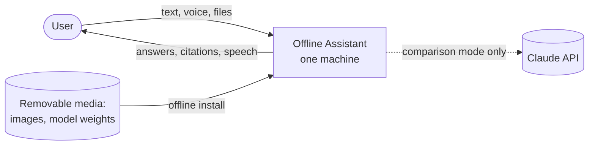
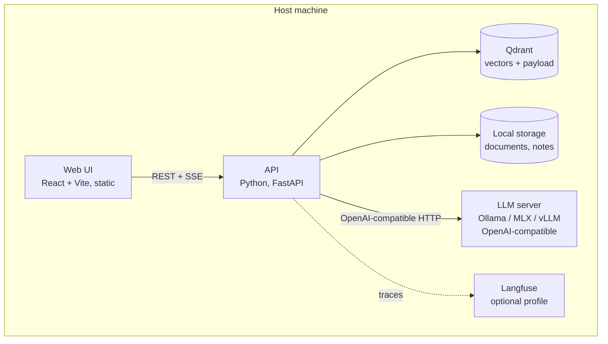
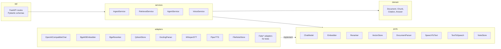
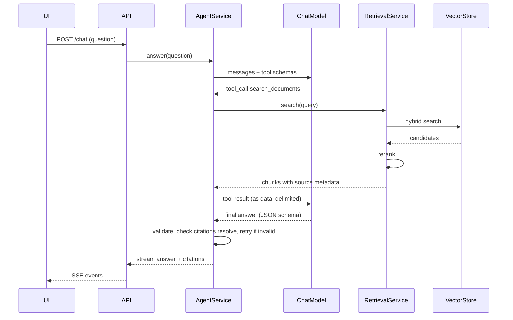

# Architecture

Status: initial design, before implementation · Last updated: 2026-10-28

This document describes the target shape of the system. Decisions behind it are in [adr/](adr/). Requirements are in [prd.md](prd.md).

## 1. Context



Everything inside the box runs on one machine. The dotted line is the only network connection the system may make, and only with an explicit flag (ADR 0004).

## 2. Containers



The embedding model, reranker, speech-to-text and text-to-speech run inside the API process (or a worker it owns). Only the LLM runs in a separate server, because it is the component we swap and benchmark, and every serving option exposes the same OpenAI-compatible API (ADR 0003).

## 3. Backend structure: ports and adapters



Rules (ADR 0002):

- `domain` imports nothing outside the standard library and Pydantic.
- `services` depend on `ports` (Python `Protocol`s) and `domain`, never on `adapters`.
- `adapters` are the only place that imports third-party model, database or parsing libraries.
- Wiring happens in one composition root (`app.py`), driven by configuration.
- Every port has a fake adapter. Unit tests use fakes; integration tests use real adapters.

## 4. Main flow: a question



Voice wraps this flow: speech-to-text before `answer`, and text-to-speech on each completed sentence of the stream.

## 5. Data model (initial)

| Entity | Key fields |
|---|---|
| Document | id, title, language, source file, checksum, ingestion status |
| Chunk | id, document id, article, paragraph, page, language, text, embedding |
| Citation | chunk id, quoted span |
| Answer | text, citations, refused flag, model id, timings |

Chunk identity is stable across re-ingestion of the same file (derived from document checksum and structural position), so evaluation datasets can reference chunks.

## 6. Deployment profiles

| Profile | LLM server | Everything else | Use |
|---|---|---|---|
| `mac` (default) | Ollama or MLX, native on the host | Docker Compose | Reference hardware; Docker on macOS cannot use the Apple GPU (ADR 0007) |
| `gpu` | vLLM in Docker Compose | Docker Compose | Linux with NVIDIA GPU |
| `observability` | — | adds Langfuse | Traces and timings |
| `compare` | adds the Claude adapter | — | Evaluation only; enables network egress |

## 7. Offline boundary

- No component downloads anything at runtime. Models are fetched by an explicit `make models` step, which is the only step that needs the network, and can be replaced by copying from removable media.
- Telemetry is disabled in every component that has it (Qdrant, Langfuse, Hugging Face libraries, Ollama, Docling).
- CI runs the end-to-end suite with container networking disabled (NFR-01).

## 8. Repository layout

```
offline-assistant/
├── CLAUDE.md                 global rules for the coding agent
├── Makefile                  single entry point: dev, test, check, eval, offline-check
├── docker-compose.yml        profiles: mac, gpu, observability, compare
├── docs/
│   ├── prd.md
│   ├── architecture.md
│   ├── workflow.md           how work moves from idea to merge
│   ├── backlog.md            ordered feature list
│   ├── adr/                  architecture decision records
│   ├── standards/            engineering rules the agent and reviewer apply
│   ├── features/F-xx-name/   spec.md, plan.md, review.md per feature
│   └── evals/                published evaluation results
├── backend/                  Python package `assistant` (uv project)
├── frontend/                 React app (pnpm project)
├── evals/                    Promptfoo configs and datasets
├── scripts/                  model download, offline bundle, data fetch
└── .claude/                  skills, agents, hooks used to build this repository
```
