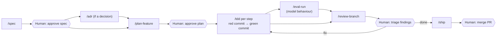

# How work is done here

This repository is built by one engineer working with a coding agent (Claude Code). This document is the process both follow. The tools that support it are in [`.claude/`](../.claude/): skills (slash commands), review agents and hooks.

The process has one aim: every change should be easy to trust. That means a written intent before code, tests before implementation, an independent review, and a history that shows all of it.

## 1. Documents and when they change

| Document | Purpose | Changes when |
|---|---|---|
| [prd.md](prd.md) | What we build and why, requirement IDs | Scope changes (rare, explicit) |
| [architecture.md](architecture.md) | Current shape of the system | A feature changes structure, flows or deployment |
| [adr/](adr/) | Why the system is shaped this way | A decision meets the criteria in [adr/README.md](adr/README.md) |
| [standards/](standards/) | Rules for code, tests and AI behaviour | Through an ADR only |
| [backlog.md](backlog.md) | Ordered list of features and their status | A feature starts, ships or is re-ordered |
| `features/F-xx-*/spec.md` | What one feature must do, acceptance criteria | Before implementation; frozen once approved |
| `features/F-xx-*/plan.md` | How the feature is built, step by step | Before implementation; steps ticked off during it |
| `features/F-xx-*/review.md` | Review findings and their resolution | During review |
| [evals/](evals/) | Published evaluation results and the baseline `make eval` gates against | After an evaluation run that changes a baseline |

Order at the start of the project: PRD → architecture → foundational ADRs → standards → backlog. After that, ADRs are written when a decision comes up, not in advance.

## 2. Choosing a track

| Situation | Track |
|---|---|
| New capability, anything touching a requirement ID | **Feature** (full track below) |
| Bug in existing behaviour | **Fix**: a test that reproduces it (red), then the fix (green), then `/review-branch` |
| Typo, docs, config, dependency bump with no behaviour change | **Chore**: branch, change, `/review-branch`, merge |
| Unknown territory: which model, which library, is it even possible | **Spike** on `spike/<topic>`: no tests, never merged; the conclusion goes into an ADR |
| A decision with no code yet | **ADR**: `/adr`, reviewed and merged on its own branch |

When unsure between Chore and Fix, it is a Fix.

## 3. Feature track



| Step | Skill | Who | Output | Commit |
|---|---|---|---|---|
| 1. Specify | `/spec F-xx` | agent interviews, human answers | `spec.md` with acceptance criteria and, for model behaviour, evaluation cases | `docs(F-xx): add spec` |
| 2. Approve spec | – | **human** | status `approved` in `spec.md` | same commit or `docs(F-xx): approve spec` |
| 3. Decide | `/adr` | agent drafts, human accepts | `adr/NNNN-*.md` | `docs(adr): ...` |
| 4. Plan | `/plan-feature F-xx` | agent researches the code and drafts | `plan.md`: ordered steps, each with its tests and files | `docs(F-xx): add plan` |
| 5. Approve plan | – | **human** | status `approved` in `plan.md` | – |
| 6. Build | `/tdd` (once per step) | agent | tests, then code | red: `test(scope): ...`, green: `feat(scope): ...` |
| 7. Evaluate | `/eval-run` | agent runs, human reads | result vs baseline in `review.md` | `test(eval): ...` for new cases |
| 8. Review | `/review-branch` | `reviewer` agent with fresh context | `review.md` with findings by severity | `docs(F-xx): add review` |
| 9. Triage | – | **human** | each finding: fix now, backlog, or reject with a reason | – |
| 10. Fix | `/tdd` | agent | red/green per finding | `test(...)` then `fix(...)` |
| 11. Ship | `/ship` | agent | acceptance criteria checked, docs updated, PR opened | `docs(F-xx): ...` |
| 12. Merge | – | **human** | merge commit on `main` | – |

The human gates are the points where judgement is needed and cheap to apply: intent (spec), approach (plan), what is worth fixing (triage), and release (merge). Everything between them is delegated.

## 4. The red/green loop

Every step in a plan runs this loop ([ADR 0009](adr/0009-test-first-commits-and-merge-strategy.md)):

1. **Red.** Write tests (or evaluation cases) that describe the step. Add only the minimal stubs needed for them to load: signatures that raise `NotImplementedError` or throw `not implemented`, no logic. Run them and confirm they fail for the expected reason, not because of a typo or an import error in the test itself. Commit:
   `test(retrieval): specify reciprocal rank fusion of dense and keyword hits`
2. **Green.** Implement the smallest change that passes. Test files are read-only in this phase; a hook rejects edits to them. Run the full check (`make check`). Commit:
   `feat(retrieval): fuse dense and keyword hits with reciprocal rank fusion`
3. **Refactor** (optional). Improve the code with tests green and unchanged. Commit:
   `refactor(retrieval): extract scoring into a pure function`
4. Tick the step in `plan.md`. Next step.

Steps that only set up tooling and add no behaviour (scaffolding a project, adding a linter, a CI job, a Makefile target) have nothing for a test to specify. They are a single `build(...)` or `ci(...)` commit, verified by running the tool, and the plan marks them `kind: setup`. The first behaviour built on top of them follows red/green.

If the green phase shows that a test is wrong, stop: go back to red, change the test in its own `test(...)` commit with the reason in the message, then continue. A test is never changed silently to make code pass.

Which loop applies to which part of the system is set by [ADR 0006](adr/0006-tdd-for-code-evals-for-model-behaviour.md) and [standards/testing.md](standards/testing.md): unit and integration tests for code, evaluation cases for model behaviour, behaviour tests for the UI.

## 5. Branches, commits, pull requests

- Branches: `feat/F-xx-short-name`, `fix/short-name`, `chore/short-name`, `docs/short-name`, `spike/topic`.
- `main` is always green. Red commits exist only on branches.
- Commit messages follow [Conventional Commits](https://www.conventionalcommits.org/). Scopes are backend modules (`ingest`, `retrieval`, `agent`, `voice`, `api`), `ui`, `eval`, `infra`, `adr`, or the feature id for docs.
- Trailers:

  ```text
  Refs: F-03
  Co-Authored-By: Claude <noreply@anthropic.com>
  ```

- One pull request per feature, merged with a merge commit. No squash.
- CI ([ADR 0010](adr/0010-continuous-integration-from-the-first-commit.md)) runs on every pull request and on `main`. It checks the commit rules above: Conventional Commit subjects, and that `feat`, `fix` and `refactor` commits do not touch tests or evaluation data. A pull request merges only with all checks green.
- The pull request description says what changed, links the spec, plan and review, shows the evaluation result if relevant, and lists the decisions the human made.

## 6. Definition of done

A feature is done when:

- [ ] every acceptance criterion in `spec.md` is met and checked off with a pointer to the test or evaluation that proves it,
- [ ] `make check` passes (format, lint, types, unit tests, contract check), and `make test-integration` and `make e2e` pass when the feature touches real adapters or the UI,
- [ ] for model behaviour: `make eval` meets the PRD targets with no regression above 5 points,
- [ ] `make offline-check` passes once it exists (from F-10),
- [ ] review findings are fixed or triaged with a reason,
- [ ] architecture, ADR index, backlog and README are up to date,
- [ ] the PR is merged by the human.

## 7. Tools

| Tool | Kind | Used in step |
|---|---|---|
| `/spec` | skill | 1 |
| `/adr` | skill | 3, any time |
| `/plan-feature` | skill | 4 |
| `/tdd` | skill | 6, 10 |
| `/eval-run` | skill | 7 |
| `/review-branch` | skill, runs the `reviewer` agent | 8 |
| `/ship` | skill | 11 |
| `reviewer` | agent, fresh context, read-only | 8 |
| `eval-analyst` | agent, read-only | 7, when a metric drops |
| `tdd-guard` | hook | 6, 10: rejects test edits in the green phase |
| `format-on-edit` | hook | every edit: formats the touched file |
| CI (`.github/workflows/ci.yml`) | GitHub Actions | every push and pull request |

Skills are deliberately few and each produces one file or one commit pair. They are thin: the rules they apply live in [standards/](standards/), so the same rules apply whether a step is done by a skill, by hand, or reviewed later.

## 8. Working with the agent

- The agent reads `CLAUDE.md` (root and per project) on every session. Those files are short and point here and to the standards.
- One feature per session where possible. A new session starts from `spec.md` and `plan.md`, not from chat history: the documents are the memory.
- The agent does not merge, push to `main`, add dependencies without an ADR, or change standards without an ADR.
- When the agent is unsure about intent, it asks. When it is unsure about facts in the code, it reads the code.
